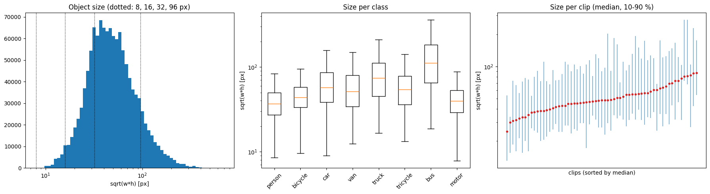
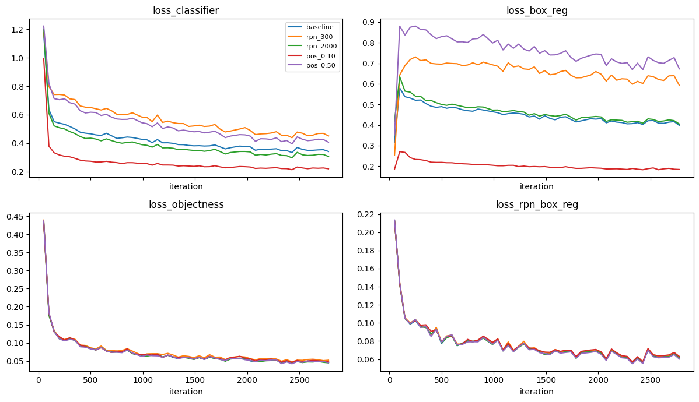
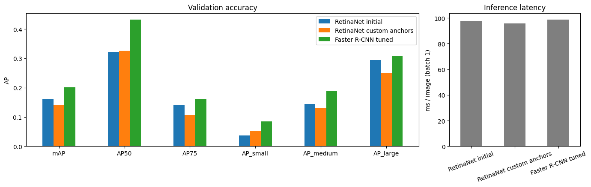

### EDA:

We've started our work with EDA to get to know our data and prepare it for our models.
We've found:
1. Significant class imbalance: cars(44.0%) and people(31.1%) together take more than 75% of the dataset, while buses are only 0.8 %. This may cause models to overfit to predicting only dominant classes and discard all other ones. For now we decided to not use any data augmentation to see how the models will perform without them, but we will include those later if we see the need for those.
2. Below you can see sizes distribution across different object types and clips. We can see that those wary highly, but the biggest part of object is at around 32 to 96 px.

3. The frames are mostly very densely covered in objects with average of 45.1% object per clip, which will be a challenge to models as they will have to be able to predict overlapping bounding boxes.
4. We converted COCO annotations into YOLO format for our models. To validate the success we sampled a few images and displayed them with ground truth boxes.
5. We didn't resize or normalize the frames during EDA step, this happens in later steps to be able to experiment with different sizes if our chosen size is too small to be able to detect smaller objects. Both resizing and validation happens inside the torchvision model, where images are resized to passed size and normalized to floats [0.0, 1.0]
6. To handle ignore regions we painted them gray during training part and ignored detections inside them while calculating scores on validation.
7. We've split the dataset into train and validate by clip with fixed seed 42. The validation dataset was chosen based on how close the percentages of different classes is to the percentages in the whole dataset. Our train data contains 55 clips and validation contains 8, which is not much and will be also used to choose best parameters for models, so we will also rely on leaderboard score for our decision.
8. As consecutive frames are very similar to each other we decided not to use all of them. To choose subsampling step we calculated persistence and mean and median IoU. Persistence remained very high even for subsampling step 10, so our main metrics was mean IoU. We chose step = 3, as it was the highest one where IoU stayed higher than 0.6, so we removed redundancy and lowered training time while still being able to see object trajectories across frames.

### Two-stage anchor based (FasterCNN)

We've decided to use Faster CNN for this task because it is faster and more lightweight then Cascade R-CNN but still accurate. We used the pretrained weights from FasterRCNN_ResNet50_FPN_Weights.COCO_V1. We chose them because they are pretrained on COCO dataset, which contains object of the same classes we are working with. This will both lower the risk of overfitting on our relatively small dataset and speed up the training process.

This is the config of our initial model:

 '# Training setup: 
 Faster R-CNN
 Model: torchvision Faster R-CNN, ResNet-50-FPN (v1), initialised from COCO weights `FasterRCNN_ResNet50_FPN_Weights.COCO_V1`; 
 box predictor replaced by a new 9-way head (8 classes + background)
 Anchors: sizes per FPN level ((16,), (32,), (64,), (128,), (256,)), aspect ratios (0.5, 1, 2)
 RPN: 1000 proposals after NMS (train and test); RoI head samples 512 RoIs/image, positive fraction 0.25
 Input: long side resized to 1536 px (aspect ratio kept); torchvision normalises with ImageNet mean/std
 Backbone: frozen BatchNorm, last 3 ResNet stages + FPN + heads trained
 Inference: score threshold 0.001, NMS IoU 0.5, max 500 detections/image
 Optimiser: SGD momentum 0.9, lr 0.005, weight decay 0.0001, cosine schedule, 300 warm-up iterations, grad-clip 10.0
 Batch size 4, 3 epochs, mixed precision: True
 Augmentation: horizontal flip p=0.5, colour jitter 0.2 (brightness/contrast/saturation, hue/4), random zoom-in crop p=0.0 (side fraction 0.5-1); ignored regions are masked in the train images
 Model selection: last epoch

We've decided to investigate two parameters:
1. Number of rpn proposals, which controls how many of candidate regions are passed to second stage. As our frames are very densely filled with objects, we wanted to make sure that too low number of proposals won't pull our performance down.
2. Box positive fraction, which controls what portion of all proposals must be positive and what portion should be background. Because our frames contain a lot of objects many of which are overlapping we wanted to make sure our model sees enough real objects and learns them.

To tune those parameters we first established the baseline, which used rpn_proposals = 1000 and box_positive_fraction = 0.25.

Then we under the same conditions changed number of rpn proposals to 300 and to 2000 and then box positive fraction to 0.10 and to 0.50.

All the runs did 3 epochs on every second prepared frame. 

Number of rpn proposals didn't change mAP much (0.120 at 1000, 0.117 at 300 and 0.116 at 2000), so we sticked with the default value of 1000.

Box positive fraction of 0.5 raised the result but only slightly (from initial 0.120 to 0.122) but when we lowered it to 0.10 mAP dropped to 0.106 because second stage trained mostly on background and wasn't able to classify objects accurately.

On the graphs above we can see that loss objectness and loss rpn box regression don't change as we change the parameters because we didn't tune any parameters which affect those.

But they did affect classifier loss and box regression loss. Box positive fraction of 0.10 differs the most significantly because second stage focuses on background and learns it quickly so loss is small. But it doesn't learn actual objects so the results are the lowest.

| experiment | rpn proposals | box positive fraction | mAP | AP50 | AP small | AP medium | AP_large | ms per img | fps | train_min |
|---|---:|---:|---:|---:|---:|---:|---:|---:|---:|---:|
| baseline | 1000 | 0.25 | 0.120 | 0.276 | 0.039 | 0.104 | 0.250 | 24.241 | 41.253 | 52.469 |
| rpn300 | 300 | 0.25 | 0.117 | 0.267 | 0.031 | 0.099 | 0.251 | 23.847 | 41.933 | 46.785 |
| rpn 2000 | 2000 | 0.25 | 0.116 | 0.270 | 0.036 | 0.101 | 0.248 | 29.511 | 33.886 | 47.150 |
| pos 0.10 | 1000 | 0.10 | 0.106 | 0.250 | 0.033 | 0.095 | 0.226 | 23.555 | 42.454 | 48.297 |
| pos 0.50 | 1000 | 0.50 | 0.122 | 0.282 | 0.035 | 0.106 | 0.255 | 26.846 | 37.249 | 47.666 |

#### Main failures:

We can see that the smaller the object the harder it is for model to detect and classify because the less pixels the object takes the easier it is for model to completely miss it or misclassify it. We will try fixing it by increasing the image size the model resizes frames to.

We also see a big gap between class agnostic and class average mAP, which shows that even when model correctly detects the object, it often struggles to classify it correctly. Class confusion is the highest for vans(38.3%), trucks(23.5%) and buses(21.7%). This is due to high class imbalance, as this is much rarer for dominant classes (people and cars).

We also see that mean best proposal IoU(0.784) is higher than mean final box IoU(0.753). This probably happens because we have both very small objects, such as people and big objects, for example buses, and the model struggles to find the optimal bounding box size to fit all of those.

The graphs and tables supporting those claims can be found in the [Faster CNN colab](./notebooks/FasterCNN.ipynb)

### One-stage anchor based (RetinaNet)

For our one-stage anchor based model we chose RetinaNet because on the contrary to other one-stage detectors, which struggle with small object it integrates Feature Piramid Network. And this is very important to us as we have objects of very different sizes.

We used pre-trained weights from RetinaNet_ResNet50_FPN_Weights.COCO_V1 for the same reasons as for FasterCNN: we don't have enough data and time to justify training the model from scratch, and those weights suit us best as they are pre-trained on similar objects to ours.

First step of tuning this model was checking and comparing anchor sizes. At image size 1536 the median size of our object is 38 px and 5% is 16.9 px. Because of this we can't use torchvision default anchors, as they start at 32px. So we will use our custom anchor sizes, which start at 5% and grow twice at each level. This raised our coverage from default 86% to 97.8%.

The next step of tuning the parameters was checking if using custom anchors yielded any results. Sadly, this only weakened model's performance. The main reason is that even though our anchors covered 97.6% of all object they were too small for medium and large objects and caused AP_medium and AP_large to drop, which dropped mAP too.

Our next step was tuning foreground and background IoU. Because our dataset contains frames with a big amount of objects which can overlap, we wanted to check if relaxing those thresholds a bit will make it easier for model to capture those. Lowering foreground IoU from default 0.5 to 0.4 and background IoU from 0.4 to 0.3 did increase mAP but only by 0.03(from 0.63 on initial model to 0.66). We tried lowering both of those 0.1 more but that only lowered the score.

The other parameter we decided to tune focal loss focusing parameter because our dataset is highly imbalanced and this focal loss controls how much the model is penalized for missing rare classes in comparison to popular classes. Setting focal_gamma to 1.0 really improved our results. 

### Comparison of two-stage and one-stage models:

Removing the region proposal stage can cause high foreground-background class imbalance. In two-stage models first stage discards background boxes so second stage can focus solely on classifying and adjusting those boxes. But when we remove the first stage the other one is forced to calculate anchors across the whole image and can easily become biased to classify everything as background. Focal loss is the main mechanism to fix this.

Overall Performance and Efficiency Metrics
| Model | mAP | AP50 | AP75 | AP_small | AP_medium | AP_large | AR500 | ms_per_img | fps | train_min |
| :--- | :---: | :---: | :---: | :---: | :---: | :---: | :---: | :---: | :---: | :---: |
| **RetinaNet initial** | 0.160 | 0.322 | 0.139 | 0.037 | 0.145 | 0.294 | 0.285 | 97.803 | 10.225 | 54.704 |
| **RetinaNet custom anchors** | 0.142 | 0.327 | 0.107 | 0.051 | 0.130 | 0.249 | 0.294 | 95.554 | 10.465 | 54.832 |
| **Faster R-CNN tuned** | 0.201 | 0.432 | 0.161 | 0.085 | 0.189 | 0.309 | 0.367 | 98.633 | 10.139 | 77.099 |

Per-Class Average Precision (AP) Breakdown
| Model | AP_person | AP_bicycle | AP_car | AP_van | AP_truck | AP_tricycle | AP_bus | AP_motor |
| :--- | :---: | :---: | :---: | :---: | :---: | :---: | :---: | :---: |
| **RetinaNet initial** | 0.178 | 0.053 | 0.355 | 0.102 | 0.098 | 0.075 | 0.322 | 0.096 |
| **RetinaNet custom anchors** | 0.177 | 0.063 | 0.329 | 0.075 | 0.071 | 0.084 | 0.241 | 0.096 |
| **Faster R-CNN tuned** | 0.215 | 0.091 | 0.387 | 0.133 | 0.145 | 0.131 | 0.360 | 0.147 |

Out of the two anchor-based models, FasterCNN showed the best performance with mAP = 0.201 and AP50 = 0.43.
It also has AP small more than twice greater than initial anchor RetinaNet's one. 
AP small is the main advantage of RetinaNet with custom anchors but due to them it lost too much on medium and large objects and its mAP turned out to be smaller than initial one.

From per-class breakdown we see that FasterCNN consistently outperformed the model across all classes and achieved the best results on cars, buses and people. This was expected for cars and people because those two are majority classes but was unexpected for buses which are a minority class. But buses are also a class with the greatest average size, so that probably made it easier for the model to learn them.

## One-Stage Anchor-Free Detection

An anchor-free detector predicts boxes directly from points of the feature map, so there are no anchor boxes to design or match. We used YOLO11s (Ultralytics) with COCO-pretrained weights. During training, each ground-truth box takes the 10 candidate points inside it that have the best task-aligned score. This score combines classification confidence and box IoU, so a point is a good positive only if it classifies and localizes well. If one point lies in several boxes, it is given to the box with the highest IoU. Boxes are trained with CIoU and distribution focal loss, classes with binary cross-entropy, and NMS is still used at inference.

This assignment is hard for small and dense objects. The finest standard level (P3) has a stride of 8, so a cell is 8 px wide. In our EDA, 9.8% of objects at 640 px are smaller than 8 px and may contain no grid point at all, so they get no positive samples. In crowded scenes (about 45 objects per frame) neighbouring boxes share the same points, and NMS can remove true neighbours. Two ways to help small objects are a stride-4 (P2) head and a larger input size.

| Model       | mAP    | AP50   | AP75   | AP_small | AP_medium | AP_large | ms_per_img | imgsz  | train time (h) |
| ----------- | ------ | ------ | ------ | -------- | --------- | -------- | ---------- | ------ | -------------- |
| af_baseline | 0.1380 | 0.2790 | 0.1244 | 0.0779   | 0.1658    | 0.2940   | 7.22       | 640    | 0.93           |
| af_1280     | 0.2188 | 0.4343 | 0.1935 | 0.1238   | 0.2085    | 0.2908   | 29.93      | 1280   | 3.55           |
| af_p2       | 0.1324 | 0.2768 | 0.1146 | 0.0964   | 0.1490    | 0.2257   | 10.97      | 640    | 1.59           |
| af_nwd      | 0.1448 | 0.2846 | 0.1331 | 0.0745   | 0.1538    | 0.2678   | 7.24       | 640    | 0.95           |
| af_box10    | 0.1455 | 0.2916 | 0.1277 | 0.0704   | 0.1469    | 0.2696   | 7.25       | 640    | 0.94           |

The baseline finds only about a quarter of objects at IoU 0.5 (AP50 = 27.9%), and it finds small objects much worse than large ones (AP_small = 7.8%, AP_large = 29.4%).

### To improve the results, we conducted the following experiments:

1. Input Resolution:
- Tuned parameter: input size 1280 instead of 640 (imgsz=1280, batch=8)
- Reason: after downscaling to 640, many objects are only a few pixels wide. At 1280 the share of objects under 16 px drops from 54% to 10% and under 8 px from 9.8% to 0.6%.
- The results: this is the only change with a large gain. mAP rose from 0.1380 to 0.2188 and AP_small from 0.0779 to 0.1238 (both about +59%). AP_medium rose by 26%, and AP_large stayed the same (0.2940 -> 0.2908), so the gain comes from small and medium objects. But, the inference is 4.1 times slower (7.2 -> 29.9 ms) and training 3.8 times longer. AP50-95 almost doubled for person (0.105 -> 0.193) and motor (0.066 -> 0.124).

2. Additional High-Resolution Head:
- Tuned parameter: extra P2 (stride 4) detection head, with a custom four-output YOLO11s config. (585 of 593 weight tensors loaded from the COCO checkpoint, matched by name and shape)
- Reason: more candidate points for small and densely packed objects.
- The results: AP_small improved (0.0779 -> 0.0964, +24%), but AP_medium and AP_large dropped (0.1658 -> 0.1490, 0.2940 -> 0.2257), so the overall mAP is slightly lower (0.1380 -> 0.1324). Inference is 52% slower. It also reached its best epoch much later (14) than the other runs. A possible reason is that the new head needs a longer schedule, but we did not test this.

3. Box Regression Loss:
- Tuned parameter: CIoU mixed 50/50 with Normalized Wasserstein Distance (nwd=0.5, C=12.8)
- Reason: IoU changes a lot when a tiny box moves by one pixel, and NWD gives a smoother signal for such boxes.
- The results: mAP rose a little (0.1380 -> 0.1448) and AP75 as well (0.1244 -> 0.1331), but AP_small did not improve (0.0745), so the expected benefit for small objects was not seen.

4. Loss Gains:
- Tuned parameter: box gain 10 and class gain 0.5 (box=10.0, cls=0.5)
- Reason: Can make the bounding boxes more precise (raise AP75)
- The results: mAP 0.1455 (+0.0075), AP75 0.1277, AP_small dropped to 0.0704.

**Search range and selected setting.** We changed one setting at a time: input size {640, 1280}, extra P2 head {no, yes}, box loss {CIoU, CIoU+NWD}, box and class gain {7.5/0.5, 10/0.5}. We did not combine settings because of the GPU budget. We selected **af_1280** as the tuned model: it has the best mAP, AP50 and AP_small, and its extra cost is paid only at inference time.

**Training behaviour.** The best epoch was early in all runs except P2 (epochs 4, 2, 14, 4 and 2 for baseline, 1280, P2, NWD and box10). After that, validation mAP50-95 fell: the last-epoch value is 0.114-0.144, against 0.151-0.212 at the best epoch. In most runs the fall starts around epoch 21, when mosaic augmentation is switched off (`close_mosaic=10`). We have only 49 training clips with many almost identical frames, so the model memorizes them quickly. Validation mAP also jumps by about 0.01 between neighbouring epochs, and we did not repeat runs with different seeds. Therefore, we treat differences below 0.01 mAP as inconclusive, which covers the NWD and box-gain results. We use `best.pt` everywhere.

**Failure analysis.** Per-class AP50-95 of the baseline: car 0.410, bus 0.323, tricycle 0.144, van 0.108, person 0.105, motor 0.066, truck 0.055, bicycle 0.033. The weakest classes are small ones (bicycle, motor, person) and not the rarest ones: bus has less than 1% of objects but a higher AP than person (30% of objects). This shows that object size is the main problem, not class imbalance.

### Comparison with anchor-based detectors (by object size)

| Model | mAP | AP50 | AP_small | AP_medium | AP_large | ms_per_img |
|---|---|---|---|---|---|---|
| YOLO11s baseline (initial) | 0.1380 | 0.2790 | 0.0779 | 0.1658 | 0.2940 | 7.22 |
| YOLO11s 1280 (tuned) | 0.2188 | 0.4343 | 0.1238 | 0.2085 | 0.2908 | 29.93 |
| Faster R-CNN, tuned | 0.2010 | 0.4320 | 0.0850 | 0.1890 | 0.3090 | 98.63 |
| RetinaNet, initial | 0.1600 | 0.3220 | 0.0370 | 0.1450 | 0.2940 | 97.80 |

The tuned anchor-free YOLO11s outperforms both anchor-based models overall, achieving the highest mAP of 0.2188 compared to Faster R-CNN's 0.2010 and RetinaNet's 0.1600. It proved to be better in detecting small objects with an AP_small of 0.1238 (surpassing Faster R-CNN's 0.0850), while also being over three times faster than the anchor-based architectures(29.93 ms per image). 

## Query-Based Detection (RT-DETR)

A query-based detector eliminates the reliance on Non-Maximum Suppression (NMS) and anchors, because bipartite matching uses the Hungarian algorithm for a strict one-to-one pairing between predictions and ground-truth objects, and uses large penalties for duplicates so the model's output is only one box per object and does not need NMS. Instead of relying on fixed grids, the model decides what to learn by finding the best match for each object. This can make the beginning of training a little unstable because these matches keep changing. Over time, different parts of the model learn to focus on specific areas and object sizes. Because of this, the is very sensitive to how the importance of bounding boxes and classification losses are balanced.

| Model         | mAP    | AP50   | AP75   | AP_small | AP_medium | AP_large | ms_per_img | imgsz |
| ------------- | ------ | ------ | ------ | -------- | --------- | -------- | ---------- | ----- |
| rtdetr_base   | 0.2332 | 0.4690 | 0.2162 | 0.1308   | 0.2188    | 0.3495   | 32.8658    | 640.0 |
| rtdetr_nq100  | 0.2307 | 0.4339 | 0.2225 | 0.1217   | 0.1940    | 0.4311   | 34.6081    | 640.0 |
| rtdetr_giou4  | 0.2457 | 0.4621 | 0.2345 | 0.1363   | 0.2208    | 0.4075   | 34.6226    | 640.0 |
| rtdetr_lr1e-4 | 0.2229 | 0.4252 | 0.2131 | 0.1182   | 0.2109    | 0.4114   | 34.6562    | 640.0 |
| rtdetr_e8     | 0.1317 | 0.2569 | 0.1258 | 0.0662   | 0.1259    | 0.2965   | 40.9422    | 640.0 |

The results show that the base model correctly identified the objects' classes in almost half of the cases (AP50 = 46.9%), but the bounding boxes were not very precise (AP75 = 21.6%). The model also finds big objects much better than small ones, but in both cases there is a lot of room to improve.

### To improve the results, we conducted the following experiments:

1. Number of Object Queries:
- Tuned parameter: number of queries 100 instead of 300 (model=rtdetr_yaml(100))
- Reason: in EDA we found out that on average in each frame there are 45 objects, and standard 300 queries can be needless.
- The results: mAP dropped (0.2332 -> 0.2307), and the overall ability to find objects got worse (AP50). AP_large increased which means that with less queries it's easier for the model to focus on dominant objects in the frame, but for general context it can be not enough.

2. Bipartite Matching Cost Weights:
- Tuned parameter: giou loss weight 4 instead of 2 (matcher=dict(giou=4))
- Reason: Can make the bounding boxes more precise (raise AP75)
- The results: The AP75 raised (0.1262 -> 0.2345), mAP raised to 0.2457 (best overall result for this metric)

3. Optimizer & Learning Rate:
- Tuned parameter: optimiser type changed to AdamW (optimizer='AdamW'), initial learning rate changed to 1e-4 (lr0=1e-4)
- Reason: The classic, stable parameters for tuning transformers.
- The results: mAP dropped to 0.2229, AP50 dropped to 0.4252.

4. Training Schedule & LR Strategy:
- Tuned parameter: training epochs changed to 8 (epochs=8), learning rate scheduler changed to cosine annealing (cos_lr=True), early stopping patience 4 (patience=4)
- Reason: check fast fine-tuning and check convergence.
- The results: mAP dropped to 0.1317, which is expected for Transformer model.

## Model Convergence & Comparison: RT-DETR vs YOLO11s

During training, we compared the convergence, accuracy, and training time of RT-DETR against the YOLO11s model at different resolutions[cite: 6]. 

**Key Findings:**
* **Accuracy:** RT-DETR models consistently outperform YOLO11s in terms of mAP50-95. The optimized `RT-DETR giou4` showed the highest overall performance, peaking near an mAP of 0.24. Increasing the YOLO11s resolution from 640 to 1280 significantly closed the accuracy gap (peaking around 0.21), but it still fell short of the RT-DETR baselines.
* **Training Time (Wall-clock):** `YOLO11s 640` is extremely fast to train, completing 30 epochs in just about 60 minutes. However, this speed comes at a heavy cost to accuracy[cite: 6]. When running `YOLO11s 1280` to improve metrics, the training time increases dramatically to over 200 minutes, making its computational cost during training comparable to the heavier RT-DETR models.

### Further experiments

To get the performance better than separate scores of two anchor based model we decided to fuse them together. Even though errors of those models are correlated as there is a similarity in how they work, we thought that together they can get rid of some of them.

Our candidates for fusion were FasterCNN with image sizes 1280 and 1960, those two with flipped data and RetinaNet with both initial and tuned anchors.
To combine predictions from different models we used Weighted Box Fusion. This way we group all overlapping detections and check if IoU is greater than our threshold. Then we calculated final bounding box position based on models' confidence. To account for the difference in models' performance we assigned each model a weight, so that worse models don't pull the score down.

To check which models will increase the score we used greedy forward selection. We took our best performing FasterCNN variations as baseline and for each further model checked if adding them will improve our score. As a result our final ensemble consists of FasterCNN with image size 1280, FasterCNN with image size 1280 and flipped inputs, FasterCNN with image size 1920 and flipped input and RetinaNet with initial anchors.This way we achieved a score 0.2205 on public leaderboard.

However, it still failed to perform better that Query based model.

## Conclusion

We compared four detector families on the same clip-level split: a two-stage anchor-based model (Faster R-CNN), a one-stage anchor-based model (RetinaNet), a one-stage anchor-free model (YOLO11s) and a query-based model (RT-DETR). The best mAP came from the query-based RT-DETR with a higher GIoU matching weight (`rtdetr_giou4`, mAP 0.2457). It was followed by the tuned YOLO11s at 1280 px (0.2188), the tuned Faster R-CNN (0.2010) and RetinaNet (0.1600). Our WBF ensemble of Faster R-CNN and RetinaNet reached 0.2205 on the public leaderboard, but it still did not beat the query-based model.

**Object size was the main difficulty.** Every model finds large objects much better than small ones, and the worst results were for classes with small objects (bicycle, motor, person), not the rarest ones. The most effective improvement for the anchor-free detector was therefore raising the input resolution. Going from 640 to 1280 px raised mAP by about 59% (0.1380 to 0.2188) and AP_small from 0.0779 to 0.1238. But it was about 4 times slower and about 4 times longer training. RT-DETR gave the best AP_small at 640 px (0.1363, vs 0.0850 for Faster R-CNN and 0.0370 for RetinaNet), and its AP_large was also the highest (up to 0.4311).

**Tuning was less decisive than the choice of architecture and resolution.** An extra P2 head helped with only small objects. NWD loss and box gain 10 changed mAP by less than 0.01, which is inside the noise of our setup (8 validation clips, one seed, mAP jumping by about 0.01 between epochs). Custom RetinaNet anchors improved AP_small but was worse on medium and large objects, so mAP dropped. In RT-DETR, a higher GIoU weight was the only change that clearly helped.

**Speed and accuracy trade-off.** YOLO11s at 640 px is by far the fastest (7.2 ms per image) but the least accurate. Faster R-CNN and RetinaNet need about 98 ms per image. RT-DETR at 640 px (about 33–35 ms) is similar in speed to YOLO11s at 1280 px (29.9 ms) and more accurate, so it is the best accuracy-per-millisecond choice in our experiments. YOLO11s at 640 px remains the option if speed matters most.

**Limitations.** The validation set has only 8 clips and was also used for choosing parameters, all models overfit quickly (best epochs were early in most runs), and we did not repeat runs with different seeds. We therefore treat small differences as inconclusive and rely on the leaderboard as an additional check.
